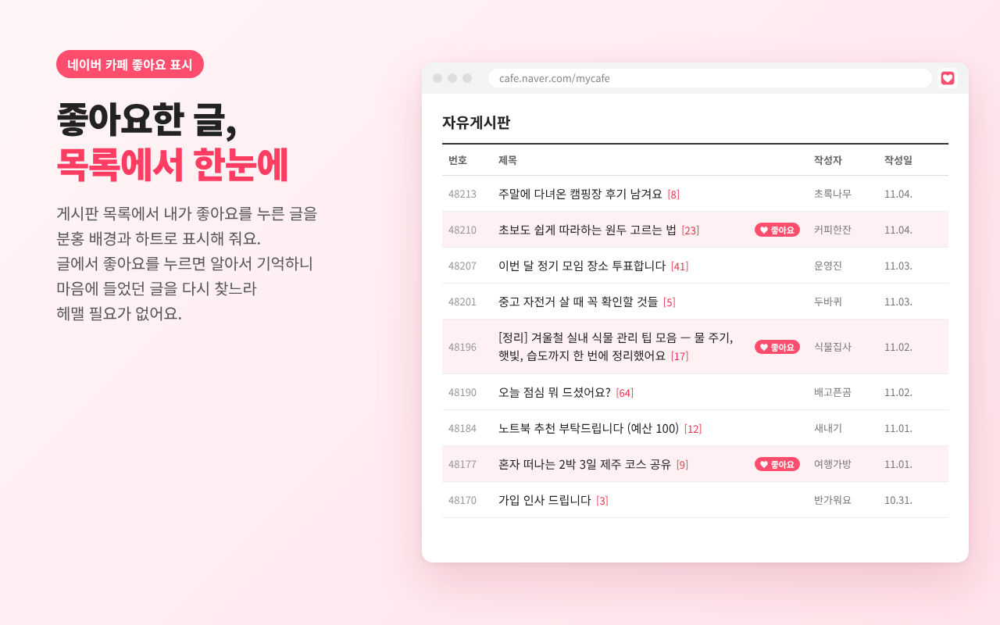

# 네이버 카페 좋아요 표시 (Chrome 확장)


좋아요를 누른 네이버 카페 게시글을 게시판 목록에서 **분홍 배경**이나 **♥ 하트**로 표시해 주는 Chrome 확장 프로그램입니다.



## 기능
- 게시글에서 좋아요 버튼을 **누를 때** 저장하고, 취소하면 지웁니다. 글을 열기만 해서는 저장하지 않습니다.
- 게시판 목록에서 저장된 글을 표시합니다.
- 툴바 아이콘을 눌러 표시 방식을 **배경만 / 배경 + 하트 / 하트만** 중에서 고를 수 있습니다. 고르는 즉시 열린 화면에 적용됩니다.
- 하트 모양도 **♥ 좋아요 / 아이콘만(♥)** 중에서 고를 수 있습니다. 하트는 줄 오른쪽 끝에 표시되며, 긴 제목은 하트 앞에서 줄바꿈되거나(여러 줄 목록) "…"로 줄어들어(한 줄 목록) 가려지지 않습니다. 제목 뒤의 사진 아이콘·댓글 수·new 표시도 가리지 않습니다.
- 하트는 제목 옆에서 글자·아이콘·사진·다른 칸과 겹치지 않는 자리를 찾아 붙습니다. 목록형, 테이블형, 칸이 나뉜 목록, 썸네일 목록, 앨범형(카드) 모두 지원합니다.
- 글 본문 속 링크에는 표시하지 않습니다. 배경은 반투명이라 어두운 화면에서도 글자가 잘 보입니다.
- 카페의 **나의 활동 → 좋아요한 글** 화면에서 확장 아이콘을 눌러 팝업의 **[좋아요한 글 모두 가져오기]**를 누르면, 페이지를 차례로 넘기며 그 카페에서 좋아요한 글을 가져옵니다(확장 설치 전 좋아요 포함). 한 번 끝까지 가져온 카페는 **[새 좋아요만 확인]**으로 새로 생긴 좋아요만 빠르게 확인합니다. 팝업을 닫아도 계속되고, 다시 열면 진행 상황과 [중지] 버튼이 보입니다. 기록은 추가만 하고 지우지 않습니다.
- 게시판 목록에서 팝업의 **[최근 좋아요한 글로 이동]**을 누르면, 그 게시판에서 가장 최근에 좋아요한 글이 있는 페이지까지 1페이지부터 차례로 넘겨 찾아가고 그 줄을 잠깐 강조합니다. 다른 게시판의 좋아요는 목록이 그 글번호를 지나치는 순간 건너뜁니다.
- 팝업 맨 위 스위치로 확장 전체를 **켜고 끌** 수 있습니다. 끄면 표시·좋아요 기록·가져오기·이동이 모두 멈추고, 저장된 기록은 그대로 남습니다.
- 모든 기록은 내 브라우저에만 저장되며, 외부로 전송되지 않습니다. ([개인정보처리방침](docs/privacy.md))

## 설치

### Chrome 웹 스토어
[Chrome 웹 스토어에서 설치하기](https://chromewebstore.google.com/detail/nmfcdiflgghgkbjdlpnjmndgajjjmfco)

### 직접 설치 (개발자 모드)
1. 이 저장소를 내려받습니다. (`Code` → `Download ZIP` 후 압축 해제)
2. Chrome에서 `chrome://extensions` 를 엽니다.
3. 오른쪽 위 **개발자 모드**를 켭니다.
4. **압축해제된 확장 프로그램을 로드합니다**를 누르고 `extension` 폴더를 선택합니다.

## 알아 두기
- 확장을 설치하기 전에 좋아요한 글은 카페의 **나의 활동 → 좋아요한 글**에서 팝업의 가져오기 버튼을 누르면 표시됩니다.
- 글은 카페 번호(clubid) + 카페 이름(주소의 영문 이름) + 글 번호(articleid)로 구분합니다. `cafe.naver.com/카페이름/123` 같은 짧은 주소도 카페 이름으로 구분하므로, 다른 카페의 같은 번호 글과 섞이지 않습니다.

## 표시가 안 될 때
네이버가 화면 구조를 바꾸면 `extension/content.js` 상단의 선택자를 고치면 됩니다.
- `LIKE_BTN_SELECTOR` : 좋아요 버튼
- `ARTICLE_LINK_SELECTOR` : 목록의 글 제목 링크

F12 → 요소 선택으로 버튼과 링크의 class를 확인해 추가하세요.

하트 위치가 이상할 때는 진단 모드를 켜면 하트 자리를 고른 이유가 콘솔에 기록됩니다.
```js
localStorage.setItem("ncl-debug", "1")   // 카페 화면의 개발자 도구 콘솔에서 입력 후 새로고침
localStorage.removeItem("ncl-debug")     // 끄기
```

## 폴더 구조
```
extension/      확장 프로그램 본체 (스토어에 올릴 때 이 폴더 안의 파일을 zip으로 묶음)
tests/          자동 테스트 (화면 구조 × 환경 5종 × 설정 5종, 동작 시나리오)
store-assets/   Chrome 웹 스토어용 스크린샷·프로모션 이미지
docs/           홈페이지·개인정보처리방침 (GitHub Pages)
tools/          아이콘·스토어 이미지 생성 스크립트
```

### 스토어 업로드용 zip 만들기
```bash
python3 tools/build_store_zip.py
```
`extension/` 원본은 그대로 두고, 주석만 뺀 복사본을 `naver-cafe-like-marker-store-v<버전>.zip` 으로 묶습니다.
변수 이름 바꾸기 같은 난독화는 하지 않습니다 (Chrome 웹 스토어 정책상 난독화 금지).
주석 제거본으로도 테스트를 돌리려면 출력 마지막 줄의 폴더를 `tests/*.py` 에 넘기면 됩니다.

### 스토어 이미지 다시 만들기
Python Playwright가 필요합니다.
```bash
cd tools
python3 render_icons.py   # extension/icons/ 아이콘 생성
python3 shoot.py          # store-assets/ 스크린샷·프로모션 이미지 생성
```

## 테스트
Python Playwright가 필요합니다.
```bash
python3 tests/harness.py extension     # tests/pages/*.html 화면 구조 × 환경 × 설정 조합 (겹침·잘림·칸 밀림·사진 크기 등)
python3 tests/scenarios.py extension   # 좋아요/취소, 설정 변경, 페이지 이동, 성능
python3 tests/liked_import.py extension # 좋아요한 글 목록에서 가져오기 (한 화면형·새로고침형·색으로만 선택 표시)
python3 tests/jump_onoff.py extension   # 최근 좋아요한 글로 이동, 켜기/끄기
python3 tests/hidden_content.py extension # 제목 길이를 바꿔 가며 아이콘·댓글 수가 하트에 가려지지 않는지
python3 tests/row_widths.py extension   # "좋아요한 글" 한 줄을 칸 폭별로 그려 겹침 확인
```
`tests/pages/gen_p19.py` 는 전체글보기 테스트 화면(p19)을 다시 만듭니다.
`tests/pages/gen_p20.py` 는 네이버 실제 CSS로 그린 화면(p20)을 만듭니다. 네이버 CSS 파일은 저장소에 넣지 않으므로, 카페 목록을 "웹페이지, 전체"로 저장해 `tests/pages/naver_css/1080_cafe.css`, `1080_skin_grey.css` 로 넣은 뒤 실행합니다. (없으면 이 화면은 건너뜀)
`tests/out/` 에 실패한 조합의 스크린샷이 저장됩니다 (`--shots` 를 붙이면 전부 저장).
